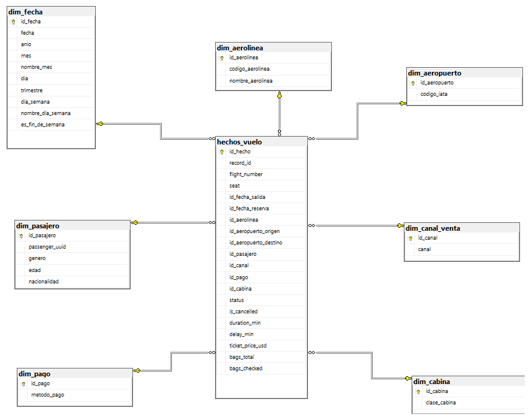

# Modelo Dimensional VuelosDW

## Diagrama

## Elección de modelo: Esquema Estrella

Se eligió **esquema estrella** sobre copo de nieve o constelación porque:

- El proceso de negocio es único (reservas/vuelos de pasajeros), no hay múltiples procesos distintos que ameriten una constelación.
- Las dimensiones son de baja/mediana cardinalidad (aerolíneas, aeropuertos, canales, métodos de pago) y no tienen jerarquías profundas que justifiquen normalizar en copo de nieve.
- Prioriza consultas simples (menos joins) y facilidad de lectura para las consultas analíticas, justo el escenario donde el esquema estrella es la recomendación estándar (Kimball).

## Tabla de hechos: `hechos_vuelo`

| Columna | Tipo | Descripción |
|---|---|---|
| `id_hecho` | BIGINT (PK) | Surrogate key |
| `record_id`, `flight_number`, `seat` | - | Claves degeneradas (identifican el registro origen, no ameritan dimensión propia) |
| `id_fecha_salida`, `id_fecha_reserva` | FK - `dim_fecha` | Rol distinto de la misma dimensión (fecha de salida del vuelo vs. fecha en que se hizo la reserva) |
| `id_aerolinea` | FK - `dim_aerolinea` | |
| `id_aeropuerto_origen`, `id_aeropuerto_destino` | FK - `dim_aeropuerto` (rol distinto) | |
| `id_pasajero` | FK - `dim_pasajero` | |
| `id_canal`, `id_pago`, `id_cabina` | FK - dimensiones respectivas | |
| `status`, `is_cancelled` | - | Estado del vuelo; se deja como atributo del hecho (no dimensión) por su baja cardinalidad y porque cambia junto con la medición, no describe contexto estable |
| `duration_min`, `delay_min`, `ticket_price_usd`, `bags_total`, `bags_checked` | - | **Medidas** |

`dim_fecha` y `dim_aeropuerto` se referencian dos veces desde la tabla de hechos con roles distintos, evitando duplicar la dimensión.

## Dimensiones y decisiones de limpieza aplicadas en el ETL

| Dimensión | Origen en el CSV crudo | Problema de calidad encontrado | Transformación aplicada |
|---|---|---|---|
| `dim_fecha` | `departure_datetime`, `booking_datetime` | Dos formatos de fecha mezclados: `DD/MM/YYYY HH:MM` y `MM-DD-YYYY HH:MM AM/PM` | Parseo con doble intento de formato antes de derivar año/mes/día/trimestre/día de semana |
| `dim_aerolinea` | `airline_code`, `airline_name` | Mismo nombre en distinto casing (`Ryanair` / `RYANAIR`, `American Airlines` / `AMERICAN AIRLINES`) | Normalización a Title Case + `strip()`, deduplicado por código |
| `dim_aeropuerto` | `origin_airport`, `destination_airport` | Casing inconsistente (`jfk`, `PTY`, `sjo`) | Normalización a mayúsculas, deduplicado |
| `dim_pasajero` | `passenger_id`, `passenger_gender`, `passenger_age`, `passenger_nationality` | Género con 6 valores distintos para 3 categorías (`M`, `m`, `Masculino`, `F`, `Femenino`, `X`) | Mapeo a `M` / `F` / `X` |
| `dim_canal_venta` | `sales_channel` | 144 filas sin canal registrado (nulo genuino, no error de formato) | Se completa con `'DESCONOCIDO'` antes de deduplicar, para no perder el resto del registro por un solo atributo faltante |
| `dim_pago` | `payment_method` | - | Deduplicado directo |
| `dim_cabina` | `cabin_class` | - | Deduplicado directo |

### Medida de precio

El CSV trae `ticket_price` (con separador decimal mixto: `"77,60"` vs `77.60`). Se usa `ticket_price_usd_est` como medida (previa validación de que no tenga nulos ni negativos) en vez de recalcular la conversión de moneda, ya que el dataset no trae tipo de cambio auditable. Usar el valor provisto por la fuente es más trazable que inventar una tasa de conversión.

### Registros nulos por cancelación

Vuelos con `status = CANCELLED` traen `arrival_datetime`, `duration_min` y `delay_min` vacíos. Esto **no es un error de calidad**, es información válida (un vuelo cancelado no tiene hora de llegada). Se preserva como `NULL` en `hechos_vuelo` y se deriva el flag `is_cancelled` para facilitar los filtros analíticos sin tener que repetir la comparación de texto contra `status`.

## Por qué no se usó una Slowly Changing Dimension (SCD)

El dataset es una extracción puntual (no hay snapshots históricos de cómo cambiaron los atributos de un pasajero o aerolínea a través del tiempo), así que no hay información para trackear cambios. Se implementa como **SCD Tipo 1** implícito (sobrescribir/último valor conocido): si se volviera a cargar el dataset, el `MERGE`/upsert simplemente actualizaría el registro existente sin conservar historial, que es la decisión correcta cuando no hay requerimiento de negocio de ver "cómo era antes".