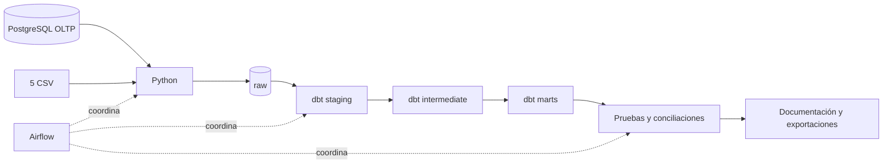

# Proyecto 1 — Flujo de datos de SG-Food

**Seminario de Sistemas 2, sección N — Grupo 26 — USAC.**

Solución ELT para ventas e inventarios con **Python, Apache Airflow, dbt Core y PostgreSQL**. Usa la base transaccional y los CSV ficticios de `Data-20260930.zip`, conserva datos crudos, construye un modelo dimensional y comprueba su calidad e integridad.

## Integrantes

| Integrante | Carné |
|---|---|
| Rodrigo Sebastian Castro Aguilar | 202204496 |
| César Augusto Francisco Vicente | 202200133 |

Datos de los integrantes registrados en [SS22S2026_G26.pdf](../SS22S2026_G26.pdf), en la raíz del repositorio.

**Entrega: miércoles 14 de octubre de 2026. Calificación presencial: 16 y 17 de octubre.** Se utilizan las fechas explícitas del aviso del curso, ya que el enunciado incluye una referencia general a 2026-1.

## Qué está implementado

- Extracción de siete tablas desde una base PostgreSQL transaccional real y carga de cinco CSV operativos mediante Python.
- Carga raw atómica con metadatos de origen, lote, conteos y hashes; reejecución sin acumular duplicados.
- 12 modelos de staging, dos intermediate y 17 marts: ocho dimensiones, cinco hechos, una tabla puente y tres reportes.
- DAG `sgfood_elt` con ocho tareas, dependencias, reintentos, registro de errores y programación diaria configurable.
- Pruebas dbt de unicidad, nulos, relaciones y reglas de negocio; PK/FK físicas y conciliaciones de conteos/importes.
- Verificación de los diez casos inválidos del curso mediante consultas dbt compiladas, dentro de transacciones revertidas.
- DDL del DW, consultas analíticas, documentación dbt, diagramas Mermaid editables y exportaciones CSV.

La [verificación del flujo](docs/verificacion.md) y los [resultados analíticos](docs/resultados.md) documentan las ejecuciones y validaciones realizadas.

## Inicio rápido

Con Docker Desktop abierto, ejecutar desde esta carpeta en PowerShell:

```powershell
python scripts/configurar_entorno.py
docker compose build pipeline
docker compose up -d postgres
docker compose run --rm pipeline python -m src.pipeline init-source
docker compose run --rm pipeline python -m src.pipeline full
docker compose up -d airflow-webserver airflow-scheduler
```

Si el entorno ya está creado, basta con `docker compose up -d postgres airflow-webserver airflow-scheduler`. Abrir **http://localhost:8081**, usuario `admin`, contraseña `AIRFLOW_ADMIN_PASSWORD` del `.env` local. El DAG queda pausado al finalizar la demostración; puede dispararse manualmente o habilitarse para ejecutar a las 06:00 de Guatemala.

**PostgreSQL:** `localhost:55432`, base `sgfood_dw`, usuario `sgfood`, contraseña `POSTGRES_PASSWORD` del `.env`. Las tablas de análisis están en `marts`. Las fuentes y los metadatos de Airflow se mantienen en bases separadas.

## Flujo



## Estructura

```text
Proyecto1/
├── README.md, Dockerfile, compose.yaml, .env.example
├── data/input/         # Fuentes originales ficticias del curso
├── data/exports/       # Marts exportados; regenerables
├── src/                # Contratos, lectura y pipeline Python
├── scripts/            # Configuración, verificación y reportes
├── airflow/dags/       # DAG sgfood_elt
├── dbt/
│   ├── models/staging/
│   ├── models/intermediate/
│   ├── models/marts/
│   ├── macros/
│   └── tests/
├── sql/                # Raw, restricciones, conciliaciones, consultas y DDL
├── tests/              # Pruebas del lector CSV
├── evidence/           # Evidencia real en JSON y registros locales
└── docs/               # Manual, diseño, diccionario, resultados y Mermaid
```

## Documentación y entrega

- [Manual de implementación](docs/manual_implementacion.md).
- [Arquitectura y justificación](docs/arquitectura.md).
- [Diccionario original](docs/diccionario_datos.md).
- [Resultados y gráficas](docs/resultados.md).
- [Verificación del flujo](docs/verificacion.md).

El README y los documentos enlazados cubren la documentación técnica admitida por el enunciado.

## Límites del análisis

Las ventas solo cuentan operaciones completadas. El inventario no se suma entre cortes mensuales. Margen, valor de inventario y devolución monetaria se identifican como estimaciones por las limitaciones de los insumos. Las promociones indican elegibilidad por categoría/fecha; no se afirma que hayan causado una venta.

Los nombres de las columnas y los conteos provienen de los datos reales: el SQL contiene **3,209 líneas de venta**, aunque el catálogo anuncia aproximadamente 3,840. No se inventaron registros para completar ese conteo.
