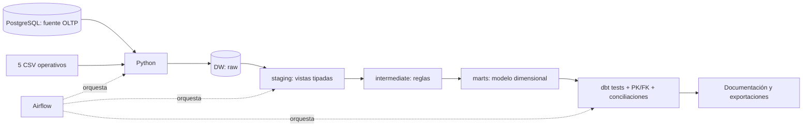

# Arquitectura y decisiones de diseño

La solución usa Python para extracción/carga, Apache Airflow 2.11.2 para orquestación, dbt Core 1.10.13 con adapter PostgreSQL 1.9.1 y PostgreSQL 16.10. Airflow y dbt tienen dependencias aisladas en la imagen para evitar conflictos entre librerías.

## Flujo

Diagramas del sistema: [arquitectura](diagramas/arquitectura.mmd), [DAG de Airflow](diagramas/dag.mmd) y [modelo dimensional](diagramas/modelo_dimensional.mmd).

## Separación de bases y capas

Un contenedor PostgreSQL aloja tres bases independientes: `sgfood_source` para `oltp_sgfood`, `sgfood_dw` para análisis y `airflow_meta` para metadatos de Airflow. Comparten instancia por simplicidad académica, sin consultar directamente la fuente desde los modelos analíticos.

En `sgfood_dw`, raw conserva campos originales como texto, con `_source`, `_source_row`, `_batch_id` y `_loaded_at`. Staging aplica casts y normalización técnica mínima; intermediate integra ventas y valida devoluciones; marts materializa tablas dimensionales y reportes. `audit.load_runs` conserva conteos y hashes de cada snapshot cargado exitosamente.

## Granos y claves

| Modelo | Grano | Clave |
|---|---|---|
| dim_fecha | Día | YYYYMMDD |
| dim_producto | Producto, incluyendo marca y categoría | id_producto |
| dim_cliente | Cliente | id_cliente |
| dim_sucursal | Sucursal | id_sucursal |
| dim_canal / dim_pago | Valor comercial | MD5 determinístico del valor |
| dim_proveedor | Proveedor | id_proveedor |
| dim_promocion | Promoción | id_promocion |
| fact_ventas | Línea original de venta | id_detalle |
| fact_inventario | Fecha de corte + sucursal + producto + lote | MD5 de la clave compuesta |
| fact_devoluciones | Devolución | id_devolucion |
| fact_metas | Mes + sucursal | MD5 de la clave compuesta |
| fact_proveedor_precio | Proveedor + producto + vigencia | MD5 de la clave compuesta |
| bridge_promocion_venta | Línea de venta + promoción potencial | Clave compuesta |

Las dimensiones con identificadores numéricos conservan la clave de la única fuente transaccional: no se implementa SCD tipo 2 porque no hay historia de cambios de atributos. El modelo reconstruye un snapshot completo y sus claves corresponden a esa fuente única.

## Reglas analíticas

- Conservar los tres estados de venta, pero contar unidades e importes vendidos únicamente para `COMPLETADA`.
- El subtotal original ya incorpora descuento. No volver a descontar promociones.
- Usar `costo_base` como referencia para margen y valor de inventario. Es una estimación, sin costos históricos, impuestos ni gastos operativos.
- No sumar inventario a través de meses. El reporte actual selecciona el último corte del dataset, no el día del equipo.
- Cantidades agregadas mezclan presentaciones comerciales. Para comparar volumen físico, filtrar por producto/unidad de medida o aportar factores de conversión que la fuente no proporciona.
- Valorar devoluciones válidas proporcionalmente al subtotal/cantidad de la línea original. Verificar línea existente, estado, fechas y cantidad acumulada; conservar diagnósticos de inválidas y excluirlas de importes.
- Comparar metas con ventas completadas, antes de devoluciones. Agregar ventas, devoluciones y metas por separado antes de unirlas por mes y sucursal.
- La tabla puente de promociones representa coincidencia por categoría y fechas. Puede tener varias promociones por línea y no implica aplicación efectiva ni causalidad.
- Las cotizaciones de proveedor no son compras ni el costo de cada venta; usar su fecha de vigencia en cualquier comparación.

## Reejecución y errores

Python carga las 12 tablas raw dentro de una transacción única, con un bloqueo consultivo y lectura consistente de la base fuente (`REPEATABLE READ`). Si falla un CSV o una inserción, PostgreSQL revierte toda la carga. La siguiente ejecución reemplaza las tablas raw y conserva el historial de lotes; no acumula duplicados.

Airflow limita el DAG a una ejecución activa, ejecuta a las 06:00 de Guatemala si se habilita y aplica un reintento por tarea. Una excepción Python o salida no cero de dbt bloquea los pasos posteriores. Las restricciones físicas son idempotentes para admitir reintentos. El DAG queda pausado inicialmente para que el usuario decida cuándo habilitar su ejecución diaria.

El reemplazo raw es atómico, pero la reconstrucción completa de todos los marts no es una única transacción global. Durante un fallo de dbt puede existir una mezcla de tablas reconstruidas y previas; solo deben consumirse resultados de una ejecución completa exitosa. Para este proyecto se evita la concurrencia y se registra evidencia de la ejecución final.

## Referencias técnicas

- [Airflow en Docker](https://airflow.apache.org/docs/apache-airflow/2.11.2/howto/docker-compose/).
- [Pruebas dbt](https://docs.getdbt.com/docs/build/data-tests).
- [Schemas de dbt](https://docs.getdbt.com/docs/build/custom-schemas).

La macro `generate_schema_name` usa nombres exactos staging/intermediate/marts en la base dedicada del proyecto.
