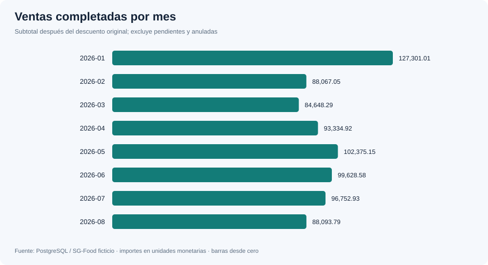
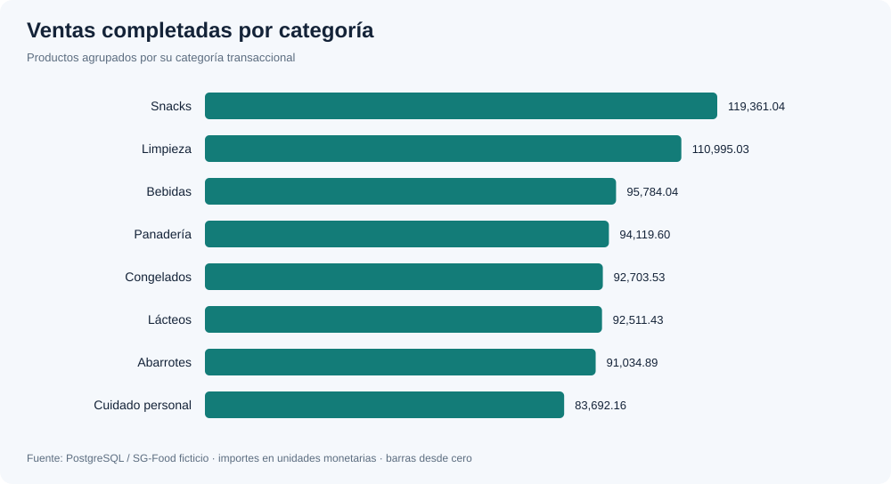
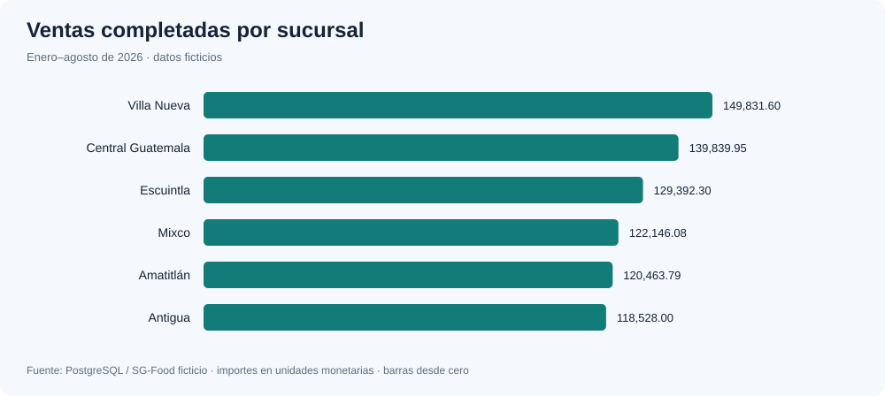

# Resultados

Consultas sobre el Data Warehouse. Los datos de origen son ficticios.

## Gráficas

## Hallazgos

- Se registraron 1,129 ventas completadas, 17,963 unidades y 780,201.72 en ventas.
- El mes de mayor venta fue 2026-01 con 127,301.01.
- Snacks lidera categorías y Villa Nueva lidera sucursales.
- El cumplimiento agregado de las metas es 8.43%. Las metas sintéticas están muy por encima de las ventas observadas; no se infieren causas del desempeño.
- Al corte 2026-08-31 hay 26 posiciones sin stock y 50 bajo mínimo, de 480 posiciones. Revisar reposición y lotes próximos a vencer.

## Resumen

| ventas_completadas | unidades_vendidas | tickets | margen_estimado | ticket_promedio |
| --- | --- | --- | --- | --- |
| 780,201.72 | 17963 | 1129 | 208,258.52 | 691.06 |

## Mensual

| periodo | ventas | devoluciones_estimadas | meta | cumplimiento |
| --- | --- | --- | --- | --- |
| 2026-01 | 127,301.01 | 522.29 | 1,049,746.03 | 0.12 |
| 2026-02 | 88,067.05 | 1,132.45 | 1,304,945.03 | 0.07 |
| 2026-03 | 84,648.29 | 906.76 | 1,118,497.89 | 0.08 |
| 2026-04 | 93,334.92 | 437.24 | 1,125,580.27 | 0.08 |
| 2026-05 | 102,375.15 | 556.01 | 1,116,571.67 | 0.09 |
| 2026-06 | 99,628.58 | 1,148.66 | 1,057,517.84 | 0.09 |
| 2026-07 | 96,752.93 | 812.17 | 1,160,512.76 | 0.08 |
| 2026-08 | 88,093.79 | 859.21 | 1,324,221.07 | 0.07 |

## Categorias

| categoria | ventas |
| --- | --- |
| Snacks | 119,361.04 |
| Limpieza | 110,995.03 |
| Bebidas | 95,784.04 |
| Panadería | 94,119.60 |
| Congelados | 92,703.53 |
| Lácteos | 92,511.43 |
| Abarrotes | 91,034.89 |
| Cuidado personal | 83,692.16 |

## Sucursales

| sucursal | ventas | meta | cumplimiento |
| --- | --- | --- | --- |
| Villa Nueva | 149,831.60 | 1,376,842.79 | 0.11 |
| Central Guatemala | 139,839.95 | 1,440,639.23 | 0.10 |
| Escuintla | 129,392.30 | 1,555,405.49 | 0.08 |
| Mixco | 122,146.08 | 1,591,727.76 | 0.08 |
| Amatitlán | 120,463.79 | 1,615,970.34 | 0.07 |
| Antigua | 118,528.00 | 1,677,006.95 | 0.07 |

## Inventario

| fecha_corte | posiciones | existencias | sin_stock | bajo_minimo | sobre_maximo | vence_en_30_dias | valor_referencia |
| --- | --- | --- | --- | --- | --- | --- | --- |
| 2026-08-31 | 480 | 22194 | 26 | 50 | 28 | 2 | 701,625.39 |

## Devoluciones

| resultado_validacion | registros | unidades |
| --- | --- | --- |
| VALIDA | 80 | 149 |

## Estados

| estado | ventas |
| --- | --- |
| ANULADA | 48 |
| COMPLETADA | 1129 |
| PENDIENTE | 23 |

## Claves

| tipo | cantidad |
| --- | --- |
| c | 4 |
| f | 21 |
| p | 14 |

## Ejecución dbt

{"pass": 119, "success": 31}

## Interpretación y límites

Ventas completadas corresponden al subtotal después del descuento original; las pendientes y anuladas se conservan pero no contribuyen a ventas. El margen es una estimación que usa costo_base actual, sin gastos, impuestos ni historial de costos. No es utilidad contable.

Las metas se comparan con ventas completadas. Su cumplimiento debe calcularse como suma de ventas / suma de metas; no promediar porcentajes de sucursales. Las devoluciones se reconocen en su propia fecha y se valoran proporcionalmente al neto de la venta, porque no se proporciona un importe de reembolso.

El inventario corresponde al último corte disponible. Las existencias no deben sumarse entre cortes: el mismo producto puede aparecer en varios meses. Los umbrales y vencimientos se calculan respecto a la fecha de corte.

Cantidades y existencias suman las unidades comerciales originales, que pueden ser cajas, botellas, paquetes u otras presentaciones. No representan un volumen físico homogéneo; para comparar volúmenes, agrupar por producto o unidad_medida y disponer de factores de conversión.

La coincidencia de una venta con una promoción representa elegibilidad potencial. El dataset no incluye un identificador de promoción aplicada; no se atribuye causalidad ni se descuenta nuevamente.
