# Proyecto 2: análisis y modelos predictivos de NYC Taxi 2022 en BigQuery

Seminario de Sistemas 2, grupo 26. Universidad de San Carlos de Guatemala.

| Integrante | Carné |
|---|---|
| Rodrigo Sebastian Castro Aguilar | 202204496 |
| César Augusto Francisco Vicente | 202200133 |

## Dataset

`bigquery-public-data.new_york_taxi_trips.tlc_yellow_trips_2022`

- Filas en origen: 36.256.539, con fechas desde 2001 hasta 2023. Solo hay viajes de enero a noviembre de 2022 (diciembre tiene 14).
- Calidad: 556 viajes fuera de 2022, 30.368 con fin anterior al inicio, 511.442 con distancia cero o negativa, 241.621 con tarifa cero o negativa, 3.135 con propina negativa y 703.499 con pasajeros fuera de 1 a 6.
- Tipo de pago: 27.531.946 viajes con tarjeta y 7.102.477 en efectivo. Las propinas en efectivo son 0 en el 100 % de los casos, por eso los modelos usan solo tarjeta.
- Tablas derivadas: todos los viajes válidos de 2022, 33.477.355 filas tras la limpieza.

## Contenido

- `sql/`: 00 a 04 y 09, preparación, exploración, tablas derivadas, consultas, optimización y tablas del tablero.
- `bqml/`: 05 a 08, datos de modelado, modelos, evaluación y predicciones.
- `docs/variables.md`: etiquetas, variables, fuga de información y partición.
- `evidencias/`: capturas de pantalla numeradas del 01 al 21, explicadas en la sección Evidencias.

Ejecutar en orden numérico, dejando `sql/09_dashboard.sql` para el final. Las consultas usan `taxi_p2.tabla` y resuelven contra el proyecto de GCP activo.

## Transformaciones

Limpieza de fechas, duración, distancia, tarifa, pasajeros y zonas, y variables derivadas (hora, día de la semana, mes, fin de semana, duración, velocidad). Detalle en `sql/02_tablas_derivadas.sql` y `docs/variables.md`.

## Optimización

| Tabla | Partición | Clustering |
|---|---|---|
| `viajes_std` | ninguna | ninguno |
| `viajes_opt` | por mes de `pickup_datetime` (`TIMESTAMP_TRUNC(pickup_datetime, MONTH)`) | `pickup_location_id`, `dropoff_location_id` |

Ambas tablas tienen las mismas 33.477.355 filas.

Resultados de `sql/04_optimizacion_comparacion.sql`, con la caché desactivada:

| Consulta | MB estándar | MB optimizada | Reducción | ms estándar | ms optimizada | ms de ranura estándar | ms de ranura optimizada |
|---|---|---|---|---|---|---|---|
| Q1, 7 días (partición) | 766,2 | 74,8 | 90,2 % | 411 | 203 | 6.141 | 401 |
| Q2, una zona (clustering) | 562,4 | 90,4 | 83,9 % | 286 | 351 | 4.120 | 2.294 |
| Q3, un mes y una zona | 665,1 | 7,2 | 98,9 % | 343 | 199 | 7.272 | 53 |

En Q2 el tiempo transcurrido es algo mayor en la tabla optimizada (decenas de milisegundos, dentro del ruido); la mejora medible está en los bytes procesados y en el tiempo de cómputo (ranura).

## Modelos

| Modelo | Tipo | Hiperparámetros |
|---|---|---|
| `reg_lineal` | regresión lineal | L2 = 0,1 |
| `reg_bt_v1` | boosted trees | 30 iteraciones, profundidad 4, tasa 0,3 |
| `reg_bt_v2` | boosted trees | 100 iteraciones, profundidad 8, tasa 0,1, subsample 0,8 |
| `reg_lineal_tuning` | regresión lineal con ajuste | `l2_reg` entre 0, 0,1, 1 y 10 (`NUM_TRIALS` = 4) |
| `clf_logistica` | regresión logística | L2 = 0,1, 20 iteraciones |
| `clf_logistica_tuning` | regresión logística con ajuste | `l2_reg` entre 0,1, 1, 10 y 100 (`NUM_TRIALS` = 4) |
| `clf_bt` | boosted trees | 60 iteraciones, profundidad 6, tasa 0,2, subsample 0,8 |
| `reg_bt_tuning` | boosted trees de regresión con ajuste | 30 iteraciones; `learn_rate` entre 0,1 y 0,3 y `max_tree_depth` entre 4 y 6 (`NUM_TRIALS` = 4) |
| `clf_bt_tuning` | boosted trees de clasificación con ajuste | 30 iteraciones; `learn_rate` entre 0,1 y 0,3 y `max_tree_depth` entre 4 y 6 (`NUM_TRIALS` = 4) |
| `reg_bt_aleatorio` | contraste de split | igual a `reg_bt_v2`, split aleatorio de 20 % |
| `reg_bt_fuga` | contraste de fuga | incluye `total_amount` |

Etiquetas, variables y justificación en `docs/variables.md`. El split principal es temporal (enero a septiembre entrenan, octubre evalúa y noviembre queda como viajes nuevos para las predicciones) y se contrasta con `data_split_eval_fraction = 0.2`.

### Regresión (hold-out temporal: octubre, 135.824 viajes)

| Modelo | MAE | RMSE | R2 |
|---|---|---|---|
| Línea base (media de entrenamiento) | 1,919 | 3,167 | |
| reg_lineal | 0,927 | 1,890 | 0,643 |
| reg_lineal_tuning (l2_reg = 10) | 0,927 | 1,890 | 0,643 |
| reg_bt_v1 | 0,970 | 1,920 | 0,632 |
| reg_bt_tuning (tasa 0,3, profundidad 6) | 0,990 | 1,922 | 0,631 |
| reg_bt_aleatorio (split aleatorio, medido en octubre) | 1,093 | 1,954 | 0,619 |
| reg_bt_v2 | 1,098 | 1,982 | 0,608 |

Contraste de split y fuga, con la evaluación interna de cada modelo (20 % aleatorio):

| Modelo | MAE | RMSE | R2 |
|---|---|---|---|
| reg_bt_aleatorio | 1,054 | 1,861 | 0,611 |
| reg_bt_fuga (con `total_amount`) | 0,531 | 1,247 | 0,829 |

Con `total_amount` el R2 sube de 0,61 a 0,83: es la fuga de información que se evita al excluirla. Los modelos reducen el RMSE de la línea base en un 40 %.

La regresión lineal supera a los boosted trees. La propina con tarjeta es casi proporcional a la tarifa (importancia de `fare_amount` 1,14, contra 0,14 de la siguiente variable), y los árboles de profundidad limitada aportan poco sobre esa relación. `reg_bt_v2`, con más iteraciones y profundidad, queda peor que `reg_bt_v1` en octubre.

### Ajuste de hiperparámetros (`NUM_TRIALS`)

`reg_lineal_tuning` prueba cuatro valores de `l2_reg` con enero a agosto como entrenamiento, septiembre para elegir y octubre como prueba:

| Prueba | l2_reg | R2 en septiembre |
|---|---|---|
| 1 | 1 | 0,6491 |
| 2 | 0,1 | 0,6490 |
| 3 | 10 | **0,6493** (óptima) |
| 4 | 0 | -6302 (diverge sin regularización) |

`clf_logistica_tuning` prueba cuatro valores de `l2_reg` y mide el ROC-AUC en septiembre:

| Prueba | l2_reg | ROC-AUC en septiembre |
|---|---|---|
| 1 | 10 | 0,7502 |
| 2 | 1 | **0,7537** (óptima) |
| 3 | 0,1 | 0,7529 |
| 4 | 100 | 0,7484 |

`reg_bt_tuning` prueba cuatro combinaciones de tasa de aprendizaje y profundidad con la misma partición TRAIN / EVAL / TEST:

| Prueba | learn_rate | max_tree_depth | R2 en septiembre |
|---|---|---|---|
| 1 | 0,3 | 6 | **0,6417** (óptima) |
| 2 | 0,1 | 4 | 0,6108 |
| 3 | 0,3 | 4 | 0,6384 |
| 4 | 0,1 | 6 | 0,6165 |

`clf_bt_tuning`, con las mismas combinaciones, mide el ROC-AUC en septiembre:

| Prueba | learn_rate | max_tree_depth | ROC-AUC en septiembre |
|---|---|---|---|
| 1 | 0,3 | 6 | **0,7653** (óptima) |
| 2 | 0,1 | 6 | 0,7636 |
| 3 | 0,3 | 4 | 0,7582 |
| 4 | 0,1 | 4 | 0,7396 |

### Clasificación (hold-out temporal: octubre)

La etiqueta `tip_alta` vale 1 si la propina es al menos el 25 % de la tarifa. Con un umbral de 20 % el 79 % de los viajes es positivo; con 25 % lo es el 59 % en octubre, y predecir siempre "propina alta" acierta el 59 %.

| Modelo | Accuracy | Precisión | Recall | F1 | ROC-AUC |
|---|---|---|---|---|---|
| clf_logistica | 0,717 | 0,699 | 0,911 | 0,791 | 0,756 |
| clf_logistica_tuning (l2_reg = 1) | 0,727 | 0,714 | 0,894 | 0,794 | 0,756 |
| clf_bt | **0,768** | **0,744** | 0,922 | **0,824** | **0,769** |
| clf_bt_tuning (tasa 0,3, profundidad 6) | 0,768 | 0,744 | 0,921 | 0,823 | 0,768 |

Matrices de confusión (umbral 0,5; filas = clase real, columnas = predicha):

| Modelo | Real 0 predicha 0 | Real 0 predicha 1 | Real 1 predicha 0 | Real 1 predicha 1 |
|---|---|---|---|---|
| clf_logistica | 24.598 | 31.339 | 7.127 | 72.760 |
| clf_logistica_tuning | 27.312 | 28.625 | 8.473 | 71.414 |
| clf_bt | 30.624 | 25.313 | 6.227 | 73.660 |
| clf_bt_tuning | 30.638 | 25.299 | 6.277 | 73.610 |

Los cuatro superan con claridad la línea base de 59 %. El recall alto con precisión moderada indica que los modelos tienden a predecir "propina alta".

### Modelo elegido

Para regresión, `reg_lineal`: menor MAE y RMSE en octubre, interpretable y de entrenamiento en segundos; el ajuste de hiperparámetros no lo mejora (`reg_lineal_tuning` empata y `reg_bt_tuning` queda por debajo). Para el rolling forecast se comparan `reg_lineal` y `reg_bt_v1`, los dos mejores. Para clasificación, `clf_bt`: mejor exactitud (76,8 %, frente a 59 % de la línea base y 71,7 % de la regresión logística), F1 y ROC-AUC.

### Predicciones sobre viajes nuevos (noviembre, 119.915 viajes)

`ML.PREDICT` sobre `ml_nuevos`, viajes que ningún modelo vio. RMSE de la propina: `reg_lineal` 1,877 y `reg_bt_v1` 1,908. La tabla `rolling_forecast` tiene la propina media diaria real y predicha de ambos modelos, con ventana móvil de 7 días, para los 30 días de noviembre. `reg_lineal` sigue de cerca a la serie real, mientras que `reg_bt_v1` queda sistemáticamente por debajo (subestima la propina media en torno a 0,1 USD); ambos reproducen las subidas y bajadas de la serie.

## Limitaciones y decisiones

- **Tamaño del dataset.** El enunciado menciona más de 100 millones de filas; la tabla tiene 36,3 millones, de enero a noviembre de 2022 (diciembre tiene 14 viajes).
- **Muestra para modelar.** Las tablas derivadas y el análisis usan todos los viajes válidos. Los modelos entrenan con 1 de cada 20 viajes con tarjeta (1,2 millones de filas), elegidos por hash, porque los boosted trees tardan varios minutos incluso así.
- **Bytes y tiempo.** La optimización se demuestra con bytes procesados y tiempo de cómputo (ms de ranura). El tiempo transcurrido, con consultas de menos de medio segundo, no cambia de forma medible.

## Hallazgos

Todas las cifras son de los 33.477.355 viajes limpios. Consultas en `sql/03_consultas_avanzadas.sql`.

- **Volumen y gasto.** Viaje promedio: 3,53 millas, 15,7 minutos, tarifa de 14,36 USD y propina de 2,70 USD (mediana 2,16; percentil 95 en 8,8). Los ingresos del año suman 708,7 millones de USD.
- **Tendencia mensual.** Enero es el mes más bajo (2,29 millones de viajes) y octubre, marzo, abril y mayo los más altos (entre 3,30 y 3,38 millones). La tarifa promedio sube de 12,61 USD en enero a 15,34 en septiembre.
- **Patrón horario.** En días laborables el máximo es a las 18 h (1.811.912 viajes) y el mínimo a las 4 h (73.454). La velocidad cae a unas 10 mph entre las 8 y las 18 h y llega a 21,9 mph a las 4 h. La tarifa promedio sube a 20,74 USD a las 5 h, frente a 14,36 USD del promedio general. En fin de semana la curva es más plana, con máximo también a las 18 h (575.463).
- **Día de la semana.** De martes a sábado hay entre 4,86 y 5,13 millones de viajes; el domingo es el día con menos (4,04 millones) y el sábado tiene la propina con tarjeta más baja (3,22 USD).
- **Tipo de pago.** 79,6 % tarjeta y 20,0 % efectivo. El efectivo registra propina 0,00 en promedio, de modo que su propina no se observa.
- **Zonas.** El aeropuerto JFK es el origen con más viajes (1.621.706), con tarifa promedio de 47,2 USD y propina promedio con tarjeta de 9,96 USD. Le siguen Upper East Side South (1.607.630) y Upper East Side North (1.416.937), con tarifas de unos 10 USD.
- **Propina y distancia.** El porcentaje de propina baja al crecer la distancia: 33,6 % en viajes de menos de 1 milla, 26,3 % de 1 a 3 y alrededor de 23 % por encima. Esto explica que la tarifa sea la variable más importante del modelo y que un modelo lineal sobre ella ya capture casi todo lo explicable.

## Informe visual

Tablero de Looker Studio conectado a tablas de BigQuery: https://lookerstudio.google.com/reporting/05ac4827-a44a-4ff8-ae6d-dc459118fe2e

- **Modelos y predicciones:** propina real frente a las predicciones de `reg_lineal` y `reg_bt_v1` en noviembre (rolling forecast, ventana móvil de 7 días), métricas de los modelos de regresión y métricas de los de clasificación.
- **Exploración de viajes:** viajes por mes, demanda por hora en días laborables y fines de semana, y porcentaje de propina por rango de distancia.
- **Detalle de modelos:** importancia de variables de `reg_bt_v2` y matriz de confusión de los cuatro clasificadores sobre octubre.

Las tablas `dash_*` que alimentan el tablero salen de `sql/09_dashboard.sql`.

## Evidencias

### Dataset y tablas derivadas

**Conteo de registros.** La tabla pública tiene 36.256.539 filas, con fechas de 2001 a 2023. `viajes_std` y `viajes_opt` tienen 33.477.355 viajes válidos de 2022; `ml_base` tiene 1.211.104 viajes (enero a octubre) y `ml_nuevos` 119.915 (noviembre).

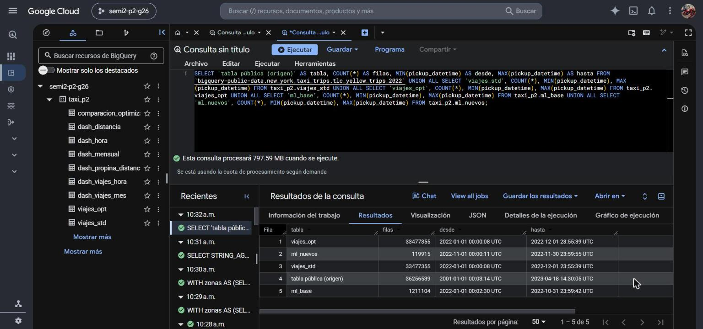

### Optimización

**Partición y clustering de `viajes_opt`.** La tabla está particionada por mes de `pickup_datetime` (12 particiones, sin vencimiento) y agrupada por `pickup_location_id` y `dropoff_location_id`.

**Bytes procesados de Q1 en la tabla estándar.** La consulta de 7 días sobre `viajes_std` procesa 766,24 MB. La misma consulta sobre `viajes_opt` procesa 74,8 MB.

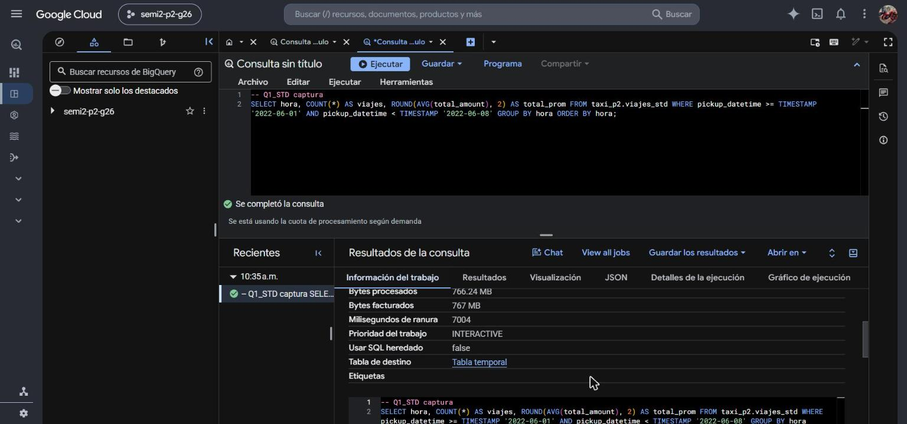

**Comparación estándar contra optimizada.** Tabla `comparacion_optimizacion`: MB procesados por Q1, Q2 y Q3 en cada tabla, porcentaje de reducción y tiempos.

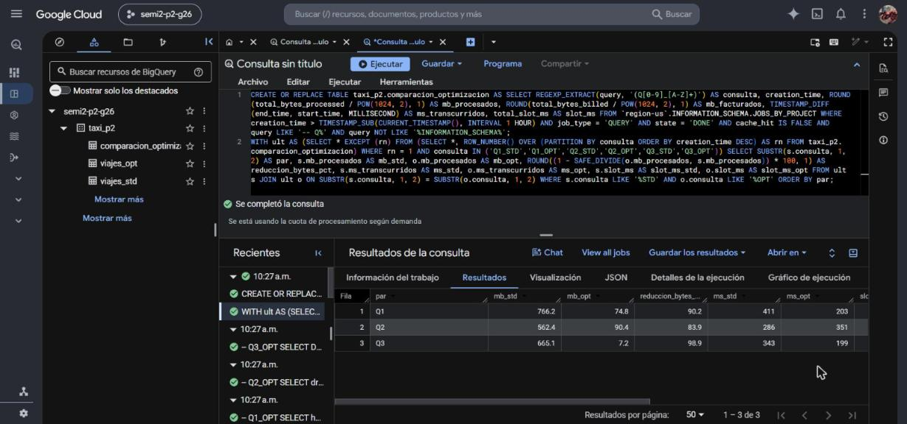

### Análisis exploratorio (`sql/03_consultas_avanzadas.sql`)

**Métricas descriptivas.** 33.477.355 viajes, 3,53 millas, 15,7 minutos, tarifa de 14,36 USD y propina de 2,70 USD en promedio.

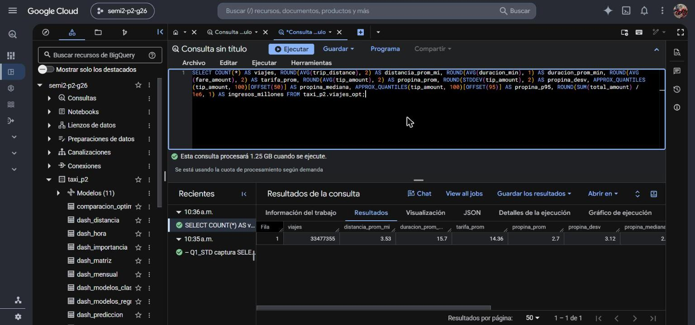

**Viajes, ingresos y tarifa por mes.** Enero es el mes con menos viajes y la tarifa promedio sube de 12,61 USD en enero.

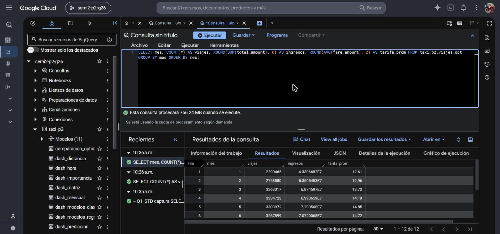

**Tipo de pago.** 79,59 % de los viajes se paga con tarjeta (propina promedio 3,39 USD) y 20,0 % en efectivo (propina 0,00 porque no se registra).

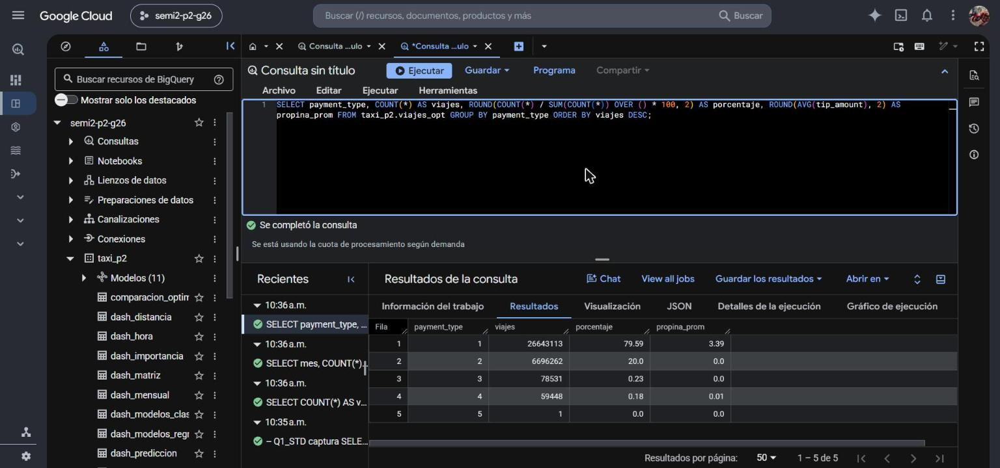

**Zonas de origen con más viajes.** El aeropuerto JFK encabeza con 1.621.706 viajes y una tarifa promedio de 47,2 USD.

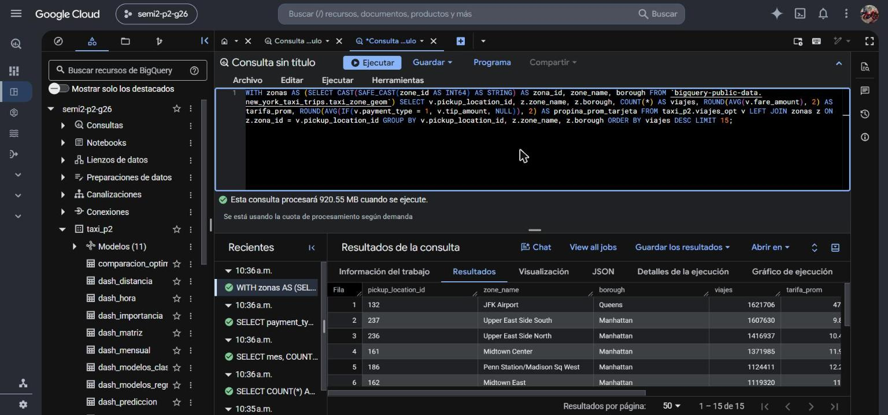

**Propina según la distancia.** El porcentaje de propina baja de 33,6 % en viajes de menos de una milla a cerca de 23 % en los largos.

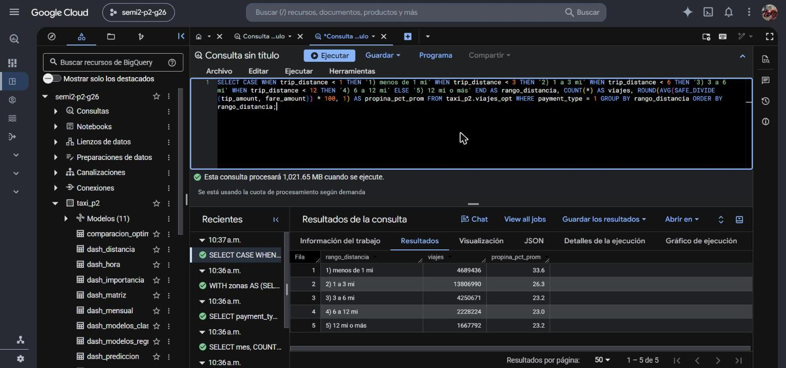

### Modelos de BigQuery ML

**Modelos creados.** Los 11 modelos del dataset `taxi_p2`.

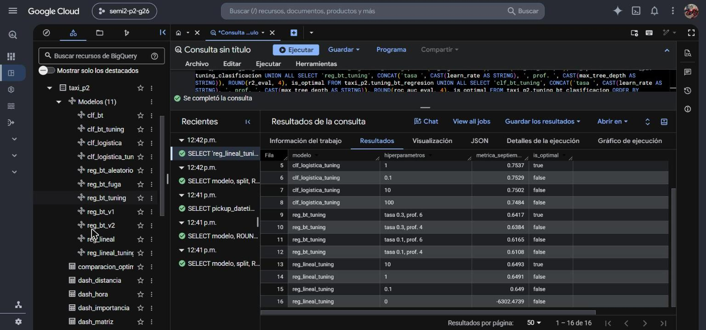

**Evaluación de los modelos de regresión.** MAE, RMSE y R2 sobre octubre. El mejor es `reg_lineal` (los dos primeros empatan en RMSE 1,89); `reg_bt_aleatorio` usa split aleatorio.

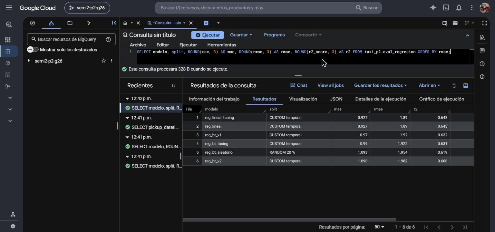

**Evaluación de los modelos de clasificación.** Exactitud, precisión, recall, F1 y ROC-AUC sobre octubre. El mejor es `clf_bt` (exactitud 0,768 y ROC-AUC 0,769).

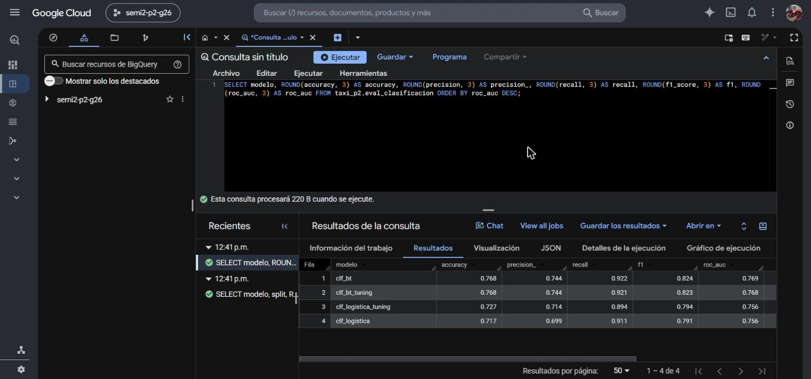

**Ajuste de hiperparámetros (1 de 2).** Cada fila es una prueba de `NUM_TRIALS`: hiperparámetros probados, métrica en septiembre y cuál resultó óptima.

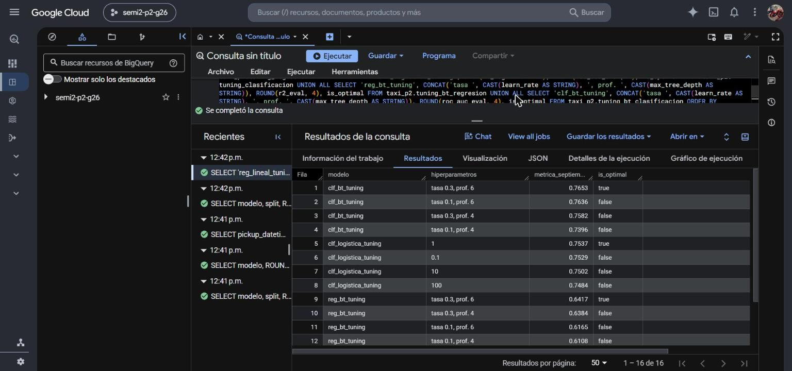

**Ajuste de hiperparámetros (2 de 2).** Resto de las pruebas. Con `l2_reg = 0` la regresión lineal diverge (R2 de -6302).

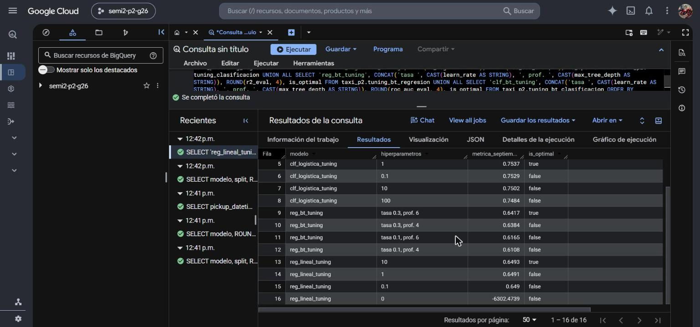

### Predicciones

**Predicciones sobre viajes nuevos.** Propina real y propina predicha por `reg_lineal` y `reg_bt_v1` en viajes de noviembre, que ningún modelo vio al entrenar.

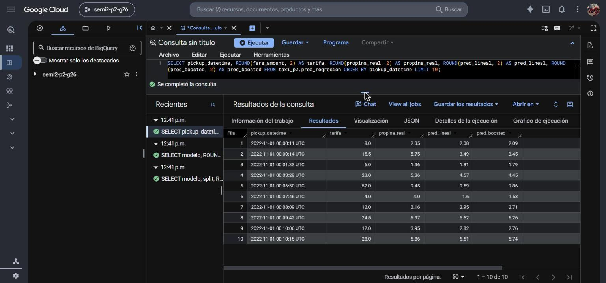

### Informe visual

**Rolling forecast.** Propina media diaria real y predicha por los dos modelos en noviembre, con promedio móvil de 7 días.

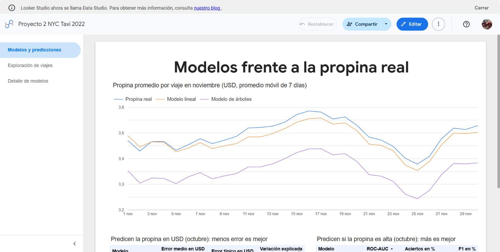

**Métricas de los modelos.** Tablas con el error y la exactitud de los modelos de regresión y de clasificación.

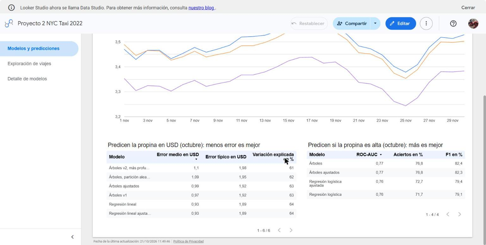

**Viajes por mes y por hora.** Los meses con más viajes y la demanda por hora en días laborables y fines de semana.

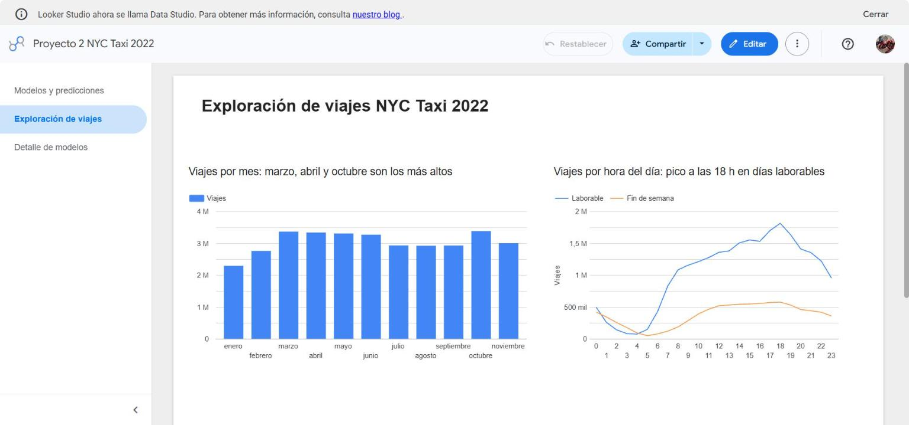

**Propina según la distancia.** Porcentaje de propina por rango de distancia.

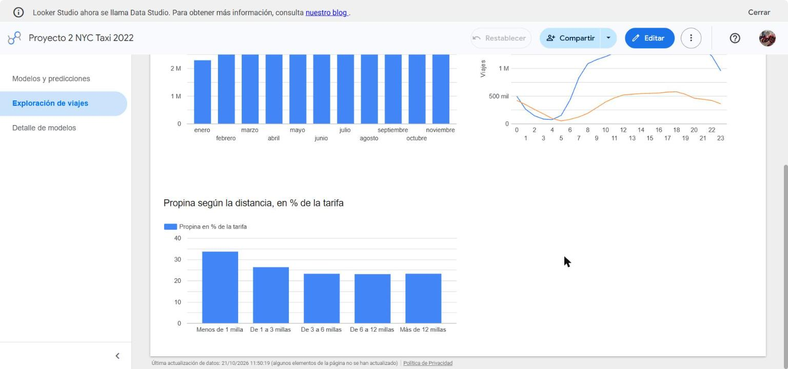

**Variables más importantes.** Importancia de cada variable en el modelo de regresión: la tarifa domina.

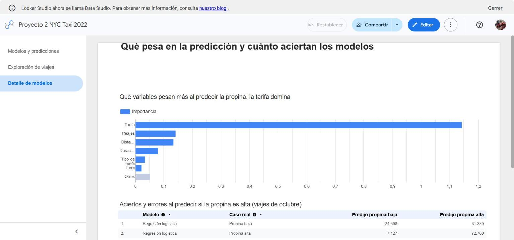

**Aciertos y errores de los clasificadores.** Matriz de confusión de cada clasificador sobre octubre.

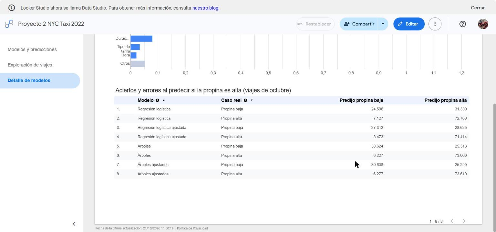
