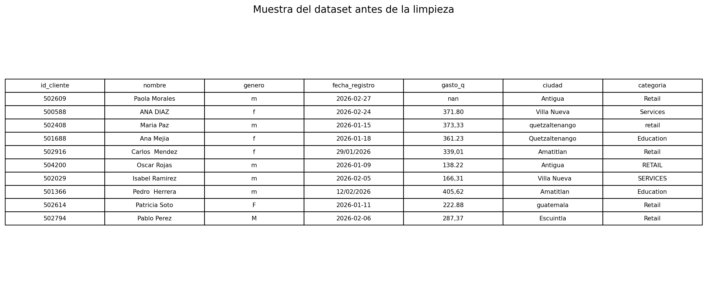
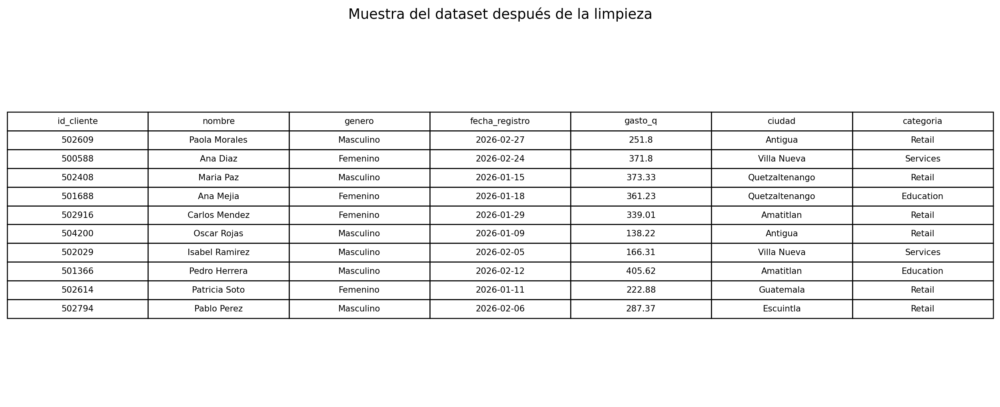
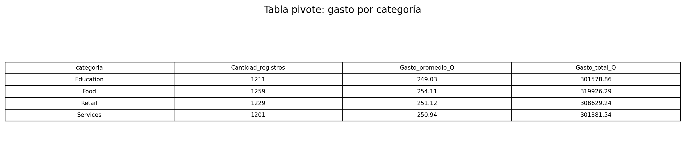
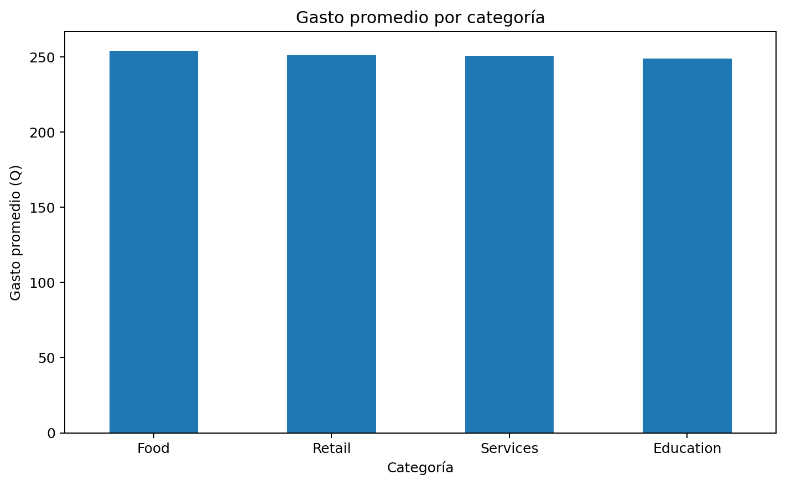
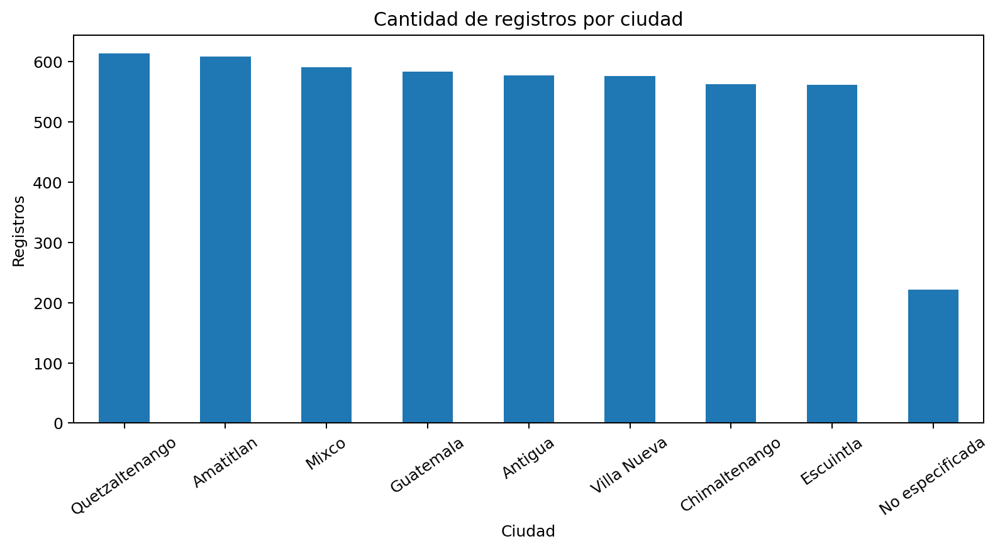

# Tarea 1 – Limpieza y análisis inicial de datos con Python y Pandas

**Curso:** Seminario de Sistemas 2  
**Dataset utilizado:** `dataset_sucio.csv`

## 1. Descripción del dataset

El archivo contiene información de clientes distribuida en las siguientes columnas:

- `id_cliente`: identificador del cliente.
- `nombre`: nombre del cliente.
- `genero`: género registrado.
- `fecha_registro`: fecha asociada al registro.
- `gasto_q`: monto de gasto expresado en quetzales.
- `ciudad`: ciudad asociada al cliente.
- `categoria`: categoría del registro.

El dataset original contiene **5,000 filas y 7 columnas**.

## 2. Problemas encontrados

Durante la exploración inicial se detectaron:

- **100 filas duplicadas exactas**.
- Valores vacíos o faltantes en `genero`, `gasto_q` y `ciudad`.
- Espacios innecesarios y diferencias entre mayúsculas/minúsculas en nombres, ciudades y categorías.
- Fechas escritas en formatos diferentes.
- Valores de `gasto_q` con punto y coma como separador decimal.
- Categorías repetidas con distinta capitalización, por ejemplo `Retail`, `retail` y `RETAIL`.

## 3. Proceso de limpieza aplicado

1. Se eliminaron las filas duplicadas exactas.
2. Se limpiaron espacios al inicio, final y espacios dobles en nombres.
3. Se estandarizó el género a `Masculino`, `Femenino` y `No especificado`.
4. Se convirtieron las fechas a un formato uniforme.
5. Se convirtió `gasto_q` a tipo numérico, reemplazando la coma decimal por punto.
6. Los gastos faltantes se sustituyeron por la mediana del conjunto: **Q251.80**.
7. Las ciudades se estandarizaron y los valores vacíos se clasificaron como `No especificada`.
8. Las categorías se estandarizaron a `Education`, `Food`, `Retail` y `Services`.

Después de la limpieza el dataset quedó con **4,900 filas y 7 columnas**, sin duplicados exactos ni valores nulos.

## 4. Comparación visual antes y después

### Antes de la limpieza

En la muestra original se observan diferencias de formato, espacios sobrantes, mayúsculas y minúsculas mezcladas, fechas con formatos distintos y gastos almacenados como texto.

### Después de la limpieza

Después del tratamiento los valores presentan formatos consistentes y son más adecuados para análisis.

## 5. Exploración mediante tabla pivote

La tabla pivote resume la cantidad de registros, gasto promedio y gasto total para cada categoría.

### Interpretación

Las categorías tienen una cantidad de registros relativamente equilibrada. `Food` presenta el gasto promedio más alto, aunque la diferencia con las demás categorías no es muy amplia. Esto sugiere que el gasto se distribuye de manera relativamente homogénea entre las categorías.

## 6. Visualizaciones

### Gasto promedio por categoría

**Interpretación:** Los promedios son cercanos entre sí. `Food` se encuentra ligeramente por encima del resto, por lo que no se observa una diferencia extrema entre las categorías.

### Cantidad de registros por ciudad

**Interpretación:** Las ciudades conocidas tienen cantidades de registros relativamente similares. Los registros originalmente vacíos en ciudad aparecen agrupados como `No especificada`, evitando perder información durante el proceso de limpieza.
